# Atelier

<p align="center">
  <a href="docs/media/atelier.mp4">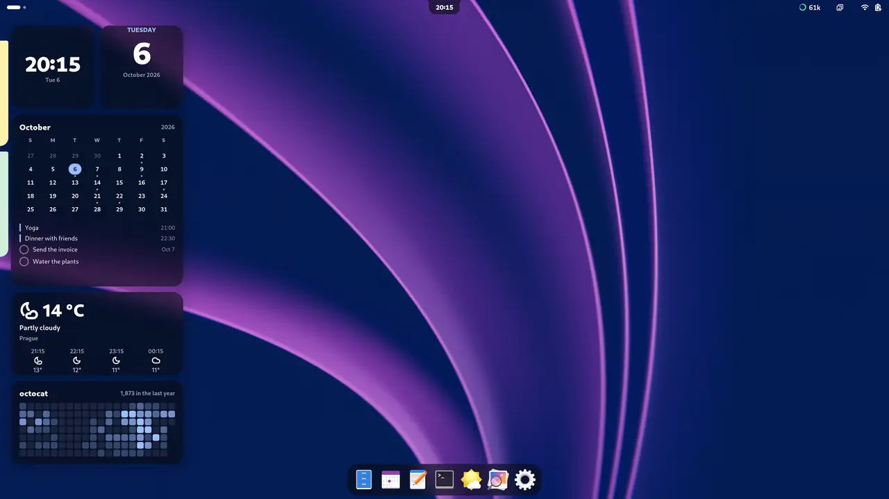</a>
  <br>
  <a href="docs/media/atelier.mp4"><b>▶ Watch the 24-second tour</b></a> (with sound): profiles, widgets that pour
  between them, the island, notes that drip out of it
</p>

A GNOME Shell extension (GNOME 48 to 50) that styles the whole desktop as one
piece. **Profiles** keep a look – wallpaper, light/dark style, accent, GTK and
shell theme, icons, cursor, font, palette, the widgets and the lock screen –
and one key switches between them. A **palette taken from the wallpaper** colors Atelier
and, if you want, GTK apps and GNOME Terminal. In the middle of the top bar,
an **island** takes the place of GNOME's clock: it grows into a glance, the
notifications and the control centre, and new notes drip out of it. On the
desktop there are **widgets** on glass, **notes** pinned to the edge of the
screen and a **dock**.

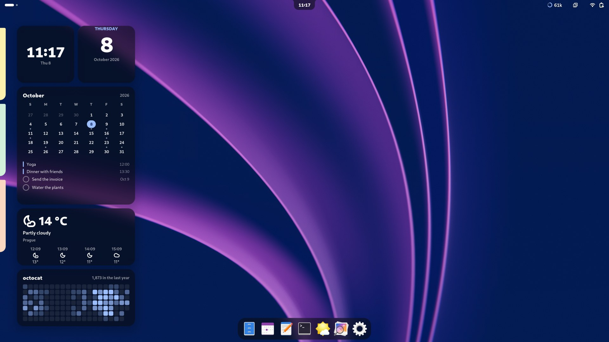

## Profiles

- **Switcher**: press <kbd>Super</kbd>+<kbd>W</kbd> (or click the button in the
  top bar). The island grows into it (without the island, a dark panel drops
  from the top of the screen), with two tabs:
  - *Profiles* – pick one with the arrow keys, scrolling or the mouse and press
    <kbd>Enter</kbd>: the island says its name, the new wallpaper is revealed
    by a growing circle under the widgets, then the themes and colors switch.
  - *Wallpapers* – the pictures in `~/Pictures/Wallpapers` (or another folder).
    Picking one changes the wallpaper for now; no profile changes.

  <kbd>Tab</kbd> switches between the tabs. Held down on a profile, it softens
  the profile into a drop of itself: <kbd>←</kbd> and <kbd>→</kbd> pour it
  along the row (its picture runs off in a stream of its own colour and fills
  the new place), and it firms up where you let go of <kbd>Tab</kbd>.
- **Profiles stay as you saved them.** A wallpaper picked for a while, or
  anything changed in GNOME Settings, leaves them alone; switching to a
  profile brings its look back. The widgets are the exception: what you change
  on the desktop is kept in the profile in use – and switching, they pour over
  to where the next profile keeps them. So is the lock screen, as on an
  iPhone: each profile has its own widgets on it, their look, the clock's
  font, weight, width and colour, GNOME's clock or not and the depth effect,
  and what you change of it (on the mock lock screen or in the settings) is
  kept in the profile in use.
- **A new profile**: pick the **+** card at the end of the Profiles tab. The
  island drips a sheet with what the desktop has now – the wallpaper, style,
  themes, palette, widgets and lock screen – to name it and choose light or
  dark and the accent; *More in Settings…* opens the rest.
- **Settings** live in the preferences: open *Extension Manager* (or
  *Extensions*) and click the gear next to Atelier.
- **Other extensions**: a few get in Atelier's way – Blur my Shell's lock
  screen blur, Tiling Shell's snap assistant, Just Perfection's banners,
  pop-ups or bar at the bottom, Dynamic Music Pill in the top bar. Under
  *Other Extensions* in the settings, Atelier can keep that one setting of
  each out of its way: only once you switch it on, putting it back when you
  switch it off, and leaving it to you if you change it there yourself. It
  never turns an extension on or off. When one is in the way, a
  notification says so, once.

When Atelier starts for the first time it saves your current setup as a
profile called **Original**, so there is always a way back.

<table>
  <tr>
    <td width="50%">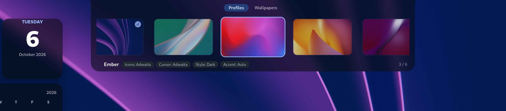</td>
    <td width="50%">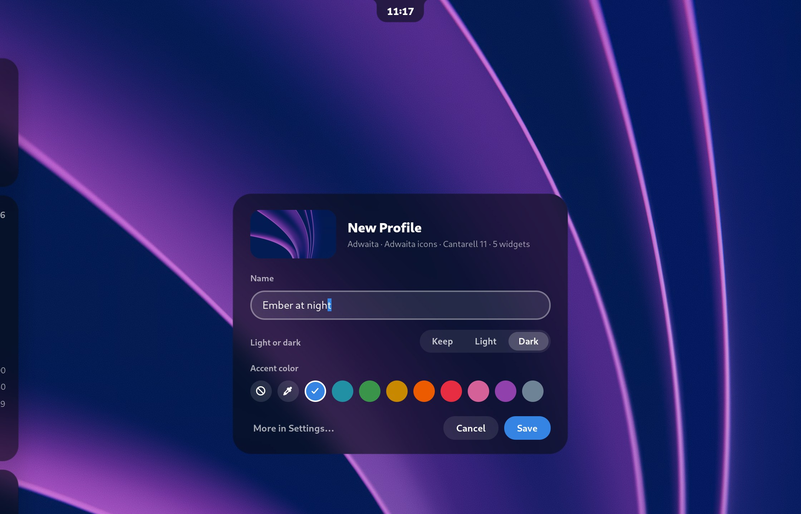</td>
  </tr>
  <tr>
    <td align="center"><sub>The switcher grows out of the island</sub></td>
    <td align="center"><sub>A new profile, on a sheet that drips from the island</sub></td>
  </tr>
  <tr>
    <td colspan="2">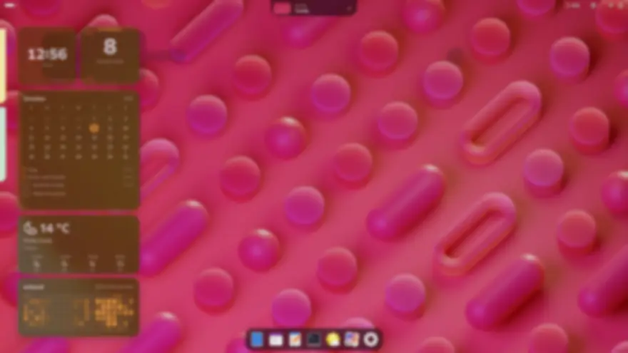</td>
  </tr>
  <tr>
    <td colspan="2" align="center"><sub>Another profile: its look comes in, and the widgets pour over to its places</sub></td>
  </tr>
</table>

## The island

- **Island**: a black capsule (or glass) in place of GNOME's clock. It shows
  the time (and a microphone while an app records, a dot for unseen
  notifications, the Do Not Disturb icon). Rest the pointer on it for a
  glance – a big clock, this week, what's left of today's events and the
  weather, from GNOME's own calendar and weather. Clicking it opens the
  control centre. GNOME's power button in the control centre opens a power
  menu in the island (Lock, Suspend, Log Out, Restart, Power Off); after a
  profile switch the island briefly shows its name.
- **Notifications** appear in the island instead of under the top bar. GNOME
  still decides what shows (Do Not Disturb, its per-app settings, the queue)
  and they stay in the notification list. Per app you choose the buttons:
  the app's own, none, or *Reply* and *Mute* (Reply opens the conversation;
  Mute keeps the app's banners away for an hour, 8 hours or until you unmute
  it in the settings). WhatsApp (as a Chrome app) starts with Reply and Mute,
  Claude with none.
- **Control centre**: click the island (or <kbd>Super</kbd>+<kbd>S</kbd>) for
  GNOME's quick settings in the island – sound, brightness, Wi‑Fi, Bluetooth,
  power mode, night light, dark style, keyboard light, airplane mode and the
  tiles of extensions such as Caffeine, with their menus. Further tabs hold
  GNOME's notification list with Do Not Disturb (<kbd>Super</kbd>+<kbd>V</kbd>),
  the calendar with the day's events, the notes, Claude Code's numbers and the
  icons extensions put into the top bar, as tiles that do what the icons did.
  Apps that live in a tray (Blip, Discord, Steam…) need the AppIndicator
  extension (`gnome-shell-extension-appindicator`); their tiles carry the
  app's name, a click opens the app and the right button its menu.
  GNOME's own menus don't open anymore; the status icons in the bar only show
  the state. Of glass, the open island is live: the windows under it show
  through, blurred.
- **Lock screen**: the wallpaper stays sharp until the password is asked.
  Then it turns to glass – blurred as GNOME blurs it, but its colours kept,
  a little richer, darker only towards the corners – the island comes out of the top edge with a padlock in a
  ring of ticks, and a popup of its own – the user's picture and name over
  the field, Enter sends it – spreads out of a drop in the middle of the
  screen, while a clock of hours over minutes puts its minutes beside its
  hours, as a digital clock, and goes up over the popup if it is still in
  its way. A wave runs round the ring while GNOME checks the password (or a
  face, with a PAM module such as Howdy), the ring shows faintly while a
  fingerprint reader waits, on a failure the ring cramps up in red as the
  padlock gives a jerky shake, and as the screen unlocks it springs open and
  hops for joy in a green ring that spreads out a little. What is typed goes
  to GNOME, which still does all the checking (and its own prompt shows
  whenever GNOME asks for something else). Clocks – a stacked one too, the
  date over big hours over dimmer minutes – the date, and the weather and
  the battery in a line can be placed anywhere on it, on a mock lock screen
  opened from the settings' Lock Screen page. Their type is in a tone of the
  palette's hue, light or dark, picked from the wallpaper behind them so
  that it is legible there (contrast as APCA measures it), or in a color
  of one's own – any, or one of the wallpaper's that the settings offer,
  each shown where the clocks are; a part that would not read as it is is
  set a little heavier, or gets a soft shadow round its letters, and only
  that part. The glass clock is an iPhone's: the time in one line of tall
  digits under a small date line, the font's own outlines grown taller
  along their straight stems (curves and bars keep their weight), in Liquid
  Glass – the wallpaper frosted behind them, tinted from what is behind,
  light along their edges – and, with the depth effect, standing behind
  what is near by a quarter of their height; as the minute turns, only the
  figures that change rise into place.
  Its font is Inter or Roboto Flex (variable fonts that come with Atelier,
  loaded into the shell only), the shell's, or a rounded or serif one
  installed, the clocks' digits in the weight and width of one's choice.
  The weather is GNOME's as it last had it, never fetched anew. Nothing on
  the lock screen opens an app, reads the network or shows notifications;
  everything else of Atelier stops while it is locked.
  With the **depth effect** (off at first), what stands near in the
  wallpaper – a hill, a town, a person, the frame of a window – stands in
  front of the lock screen's own clocks, as on an iPhone, but never in
  front of the date over a clock, and the sky, distant mountains or the
  view out of a window stay behind them; it goes as the prompt comes up and
  the wallpaper blurs, and stays off where what stands in front would hide
  more than a quarter of any digit of a clock, or 40 % of a clock as a
  whole (a glass clock's digits stand behind it a quarter of their height
  on purpose: the rest of each counts, and 60 % of the clock). A
  depth model, Depth Anything V2, sees how near each part of the wallpaper
  is, on this computer, in a background process of the session at the
  lowest priority, a moment after the wallpaper changes; the lock screen
  only shows the cutout made then. It needs `sudo apt install
  python3-onnxruntime python3-pil`, and one of the model's three sizes,
  which is downloaded (from Hugging Face) only from the settings' Lock
  Screen page, when you ask: Small (99 MB, Apache-2.0, seconds a
  wallpaper), Base (389 MB, CC-BY-NC-4.0: for non-commercial use, about ten
  seconds; offered first) or Large (1.3 GB, CC-BY-NC-4.0, the finest: half
  a minute or more, and about 2.5 GB of memory while it runs). A subject
  model, BiRefNet lite (224 MB, MIT, downloaded there too, only when you
  ask), finds the wallpaper's subject – a person, an animal, a thing – as
  an iPhone does; where it is sure of one (a whole shape with a sharp edge,
  of a sensible size, neither the sky, nor the land from one side to the
  other, nor a heap of bits, nor far off to the depth model), the subject
  stands in front too, with its own outline. It takes about ten seconds
  more a wallpaper, and 5.3 GB of memory while it runs; alone, without a
  depth model, only the subject stands in front.
- **Claude Code**: a ring in the bar shows how far the current 5-hour block
  is, with the tokens Claude wrote in it; resting the pointer on it (or the
  control centre's Claude tab) shows the block, today, the last seven days
  and the sessions running. Atelier reads only the token counts in Claude
  Code's local history (`~/.claude/projects`), in a background process, and
  keeps them in its cache; nothing is sent anywhere.

<table>
  <tr>
    <td width="50%">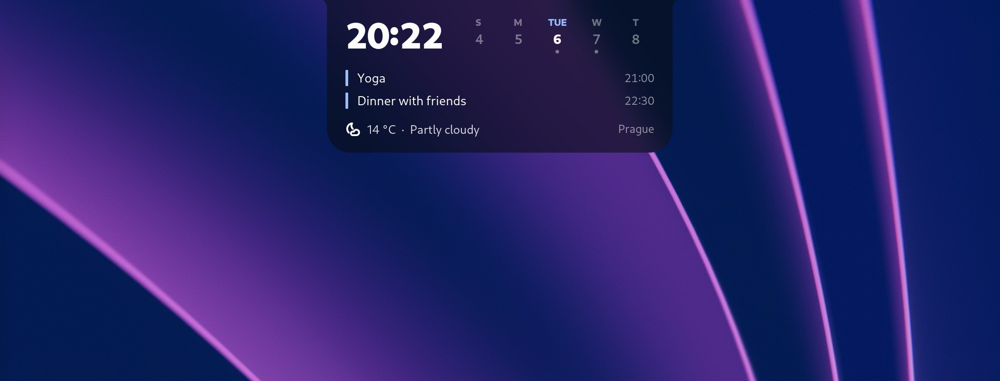</td>
    <td width="50%">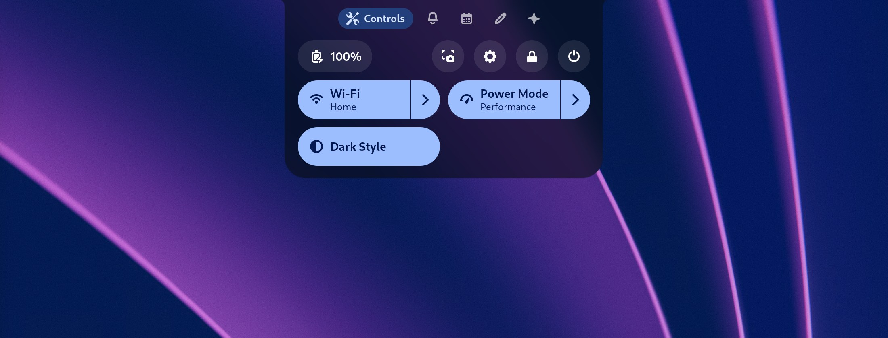</td>
  </tr>
  <tr>
    <td align="center"><sub>Resting on it: a glance</sub></td>
    <td align="center"><sub>A click: the control centre</sub></td>
  </tr>
  <tr>
    <td width="50%">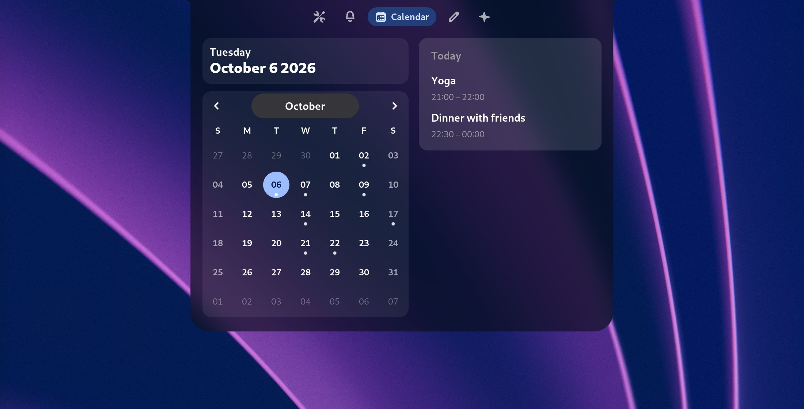</td>
    <td width="50%">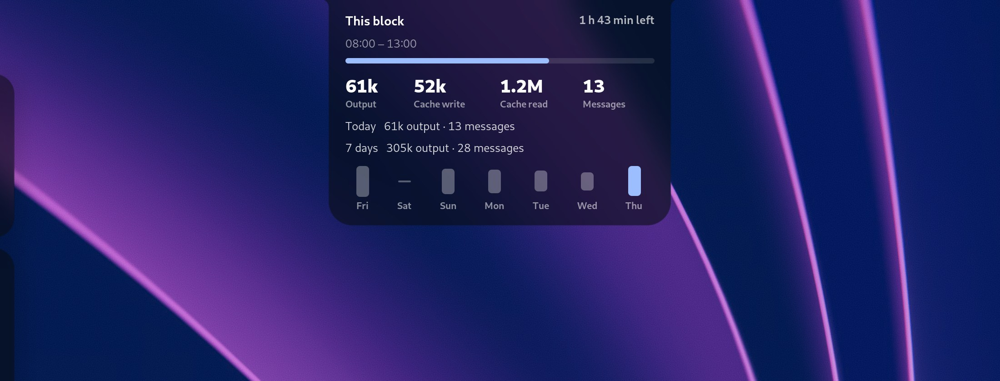</td>
  </tr>
  <tr>
    <td align="center"><sub>The calendar tab</sub></td>
    <td align="center"><sub>Claude Code's numbers, from the ring in the bar</sub></td>
  </tr>
  <tr>
    <td colspan="2">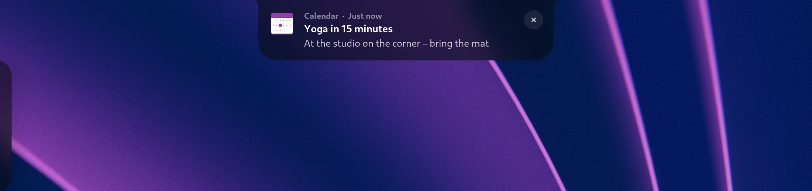</td>
  </tr>
  <tr>
    <td colspan="2" align="center"><sub>Notifications come in the island</sub></td>
  </tr>
</table>

## Top bar

*Grouped* (the workspaces, the island and the status icons together in the
middle), *Spread* (the workspaces at the left edge, the status icons at the
right one), *One island* (all of it in one island) or *GNOME*'s bar. The sides
sit on the wallpaper or in capsules like the island; the island floats below
the top edge or hangs from it as a *notch*, and it is black or **glass** –
Atelier's own blur of the wallpaper, tinted with the palette. *Only the
essentials* keeps a grouped bar or one island to the workspaces, the time and
the battery. On a monitor with a full screen window none of it shows. (If
Blur my Shell blurs the bar, turn that off.)

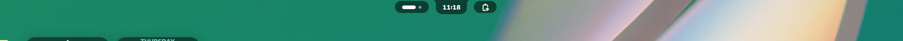

## On the desktop

- **Widgets** lie on the wallpaper, under the windows: a clock, the date, the
  month with today's events and your Google Tasks (from GNOME Online
  Accounts), the weather, anyone's GitHub contributions (from GitHub's public
  page, no account needed), Claude Code's block, a photo, and how many Slack
  messages came since you last looked at Slack and who wrote them (counted
  from its notifications; what they say is never shown or kept) – as
  *Modern* cards, on glass, or on *Analogue* paper; the clock's menu
  (right-click it) chooses its face – digital, a watch with a second hand,
  numerals or minimal hands. Right-click the desktop
  and choose *Edit Widgets*: drag one and a shadow on the grid shows where it
  lands;
  stretch one by its corner and it snaps to the nearest of its sizes (a click
  on the corner gives the next one); drag more out of the gallery at the
  bottom – a click on its clock spills the clock's faces, to drag one out.
  Switching workspaces, they slide along with the wallpaper.
- **Photos**: one gallery for all the photo widgets – Atelier keeps copies of
  its own of the pictures added, so they stay when the pictures are moved.
  Each photo widget shows those picked for it (up to 30) one after another,
  each for 5 s to a minute, the next spreading over the one before; each
  profile keeps its own choice. *Choose Photos…* in the widget's menu drips
  a sheet from the island with the gallery to pick from (in the order they
  take turns), and its **+** adds pictures through the system's file
  chooser; Settings → Desktop adds and removes photos too, and picks them for
  each photo widget. A widget takes turns only while it can be seen – not
  under windows, in the overview, on a blank or dimmed screen – so it costs
  nothing otherwise. Without photos picked, it shows a picture (or one of a
  folder's, a different one every hour) chosen in the settings.
- **Notes**: square papers in seven colors with a title, text and checkboxes
  (a line starting with `- [ ]`: <kbd>Enter</kbd> on one starts the next line
  with one too, *Checkbox* puts one on every line selected), pinned to the
  left (or right) edge of the main monitor – a strip of each peeks out, all
  of it under the pointer, with a button in its corner that puts it into the
  archive. A new note (*New Note* in the desktop's menu, or the control
  centre's Notes tab) drips from the island onto a sheet to write on (its
  title first, <kbd>Tab</kbd> on to its text), and so does a note you click;
  <kbd>Ctrl</kbd>+<kbd>Enter</kbd> saves it – a new
  one runs off to its edge in a drop, and its paper spreads out of the edge
  there. *Remind
  me* on the sheet gives a note a reminder – a day and a time, shown on its
  paper – and at that time a notification comes, with *Open* and *In 10 min*
  (one due while the computer was off or locked comes as soon as it is back).
  The Notes tab has them all, and an archive. They are the same whatever the
  profile.
- **Dock**: the pinned apps and those with windows on the workspace, at the
  bottom of the screen; it moves out of the way of windows, and the bottom
  edge brings it back. Dynamic Music Pill sits at its end. It stays off while
  Dash to Dock is enabled.

<table>
  <tr>
    <td width="50%">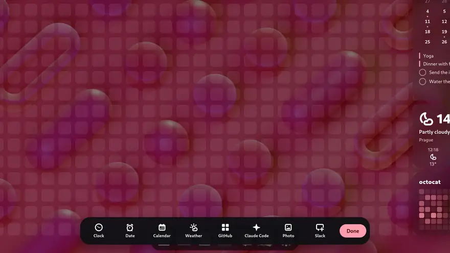</td>
    <td width="50%">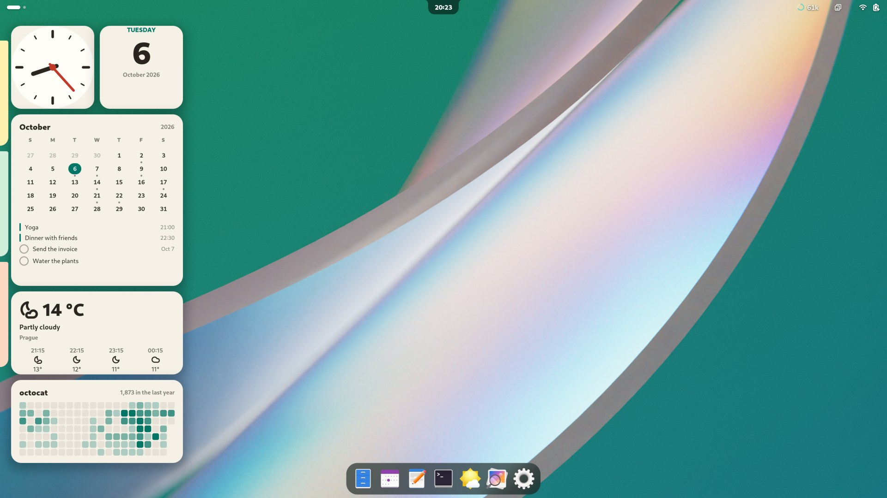</td>
  </tr>
  <tr>
    <td align="center"><sub>Edit Widgets: the clock's faces flow out of the gallery</sub></td>
    <td align="center"><sub>Analogue: paper and a clock face</sub></td>
  </tr>
  <tr>
    <td width="50%">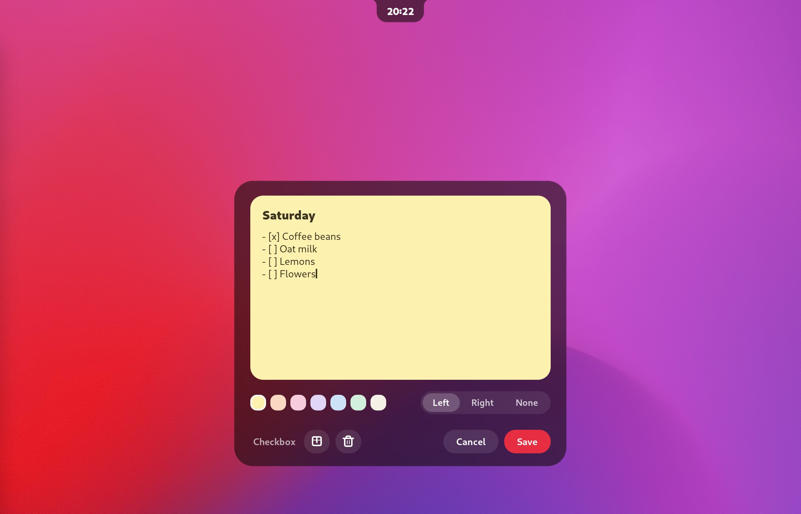</td>
    <td width="50%">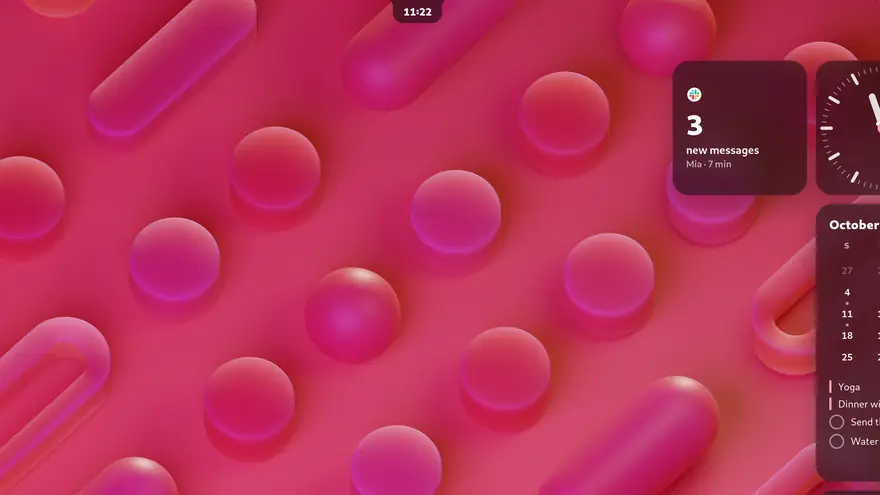</td>
  </tr>
  <tr>
    <td align="center"><sub>A note, written on a sheet from the island</sub></td>
    <td align="center"><sub>Saved, it runs off to the edge</sub></td>
  </tr>
  <tr>
    <td width="50%">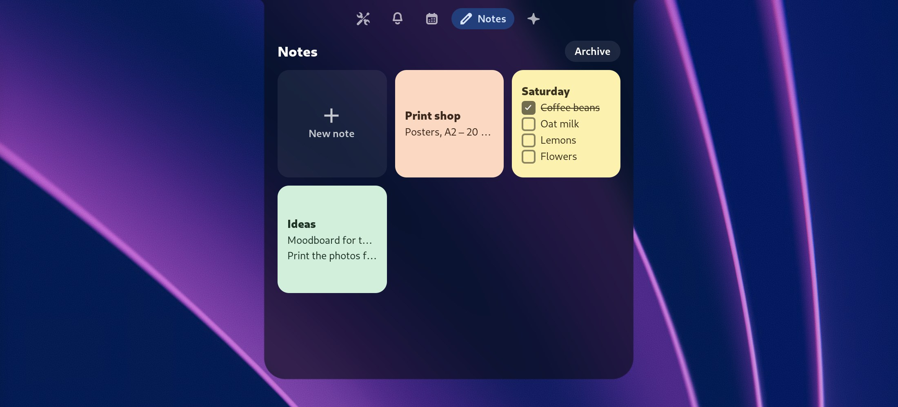</td>
    <td width="50%">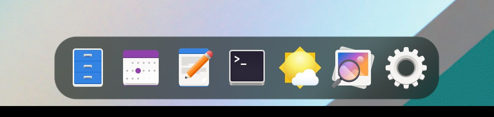</td>
  </tr>
  <tr>
    <td align="center"><sub>All of them in the Notes tab</sub></td>
    <td align="center"><sub>The dock</sub></td>
  </tr>
</table>

## Palette

The palette comes from the wallpaper: its colors are grouped into a few
swatches, the most fitting one becomes the source, and a full set of colors
for dark and light is built from it (Settings → Appearance). You can pick
another swatch or one of nine fixed palettes instead, and choose how colorful
it is (vibrant, muted, monochrome). The "Auto" accent of a profile uses it.

Optional, in Settings → Appearance:

- **Color GTK apps** – Atelier writes `~/.config/gtk-4.0/gtk.css` and
  `~/.config/gtk-3.0/gtk.css`: libadwaita apps take the palette's accent and a
  hint of its color, in both light and dark. Open apps need a restart. Atelier
  never overwrites a `gtk.css` it didn't write.
- **Color GNOME Terminal** – a terminal profile "Atelier" (a copy of your
  default profile with the palette's colors) becomes the default; switching
  the option off brings your profile back.

## Settings

<table>
  <tr>
    <td width="33%">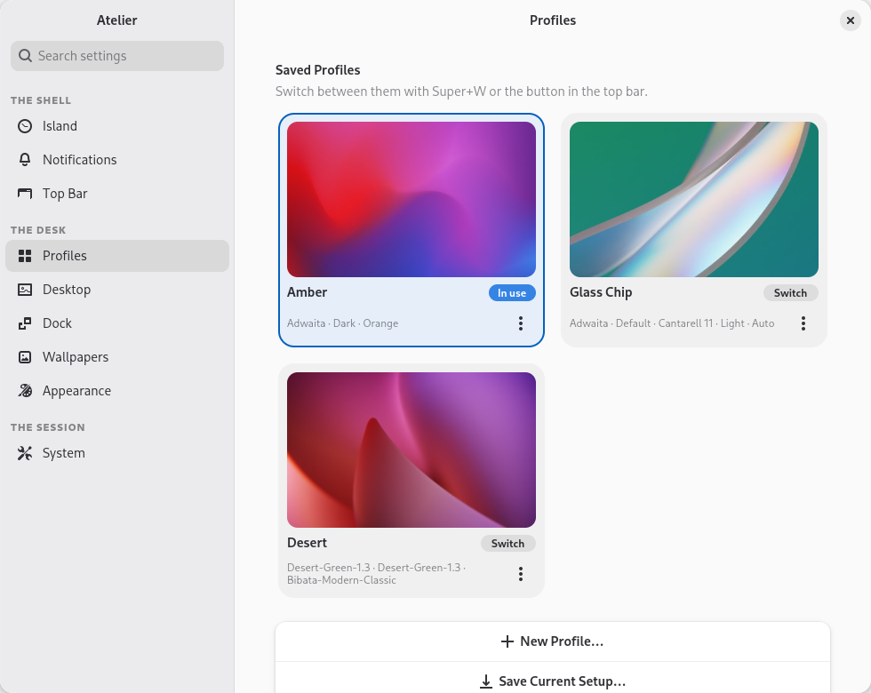</td>
    <td width="33%">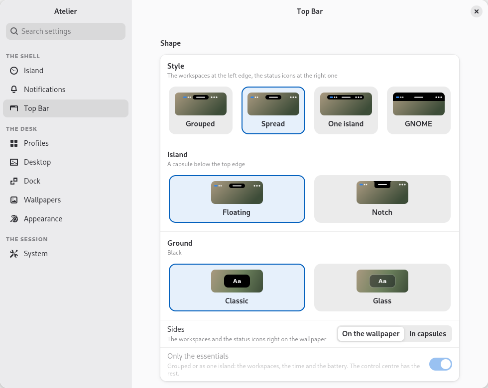</td>
    <td width="33%">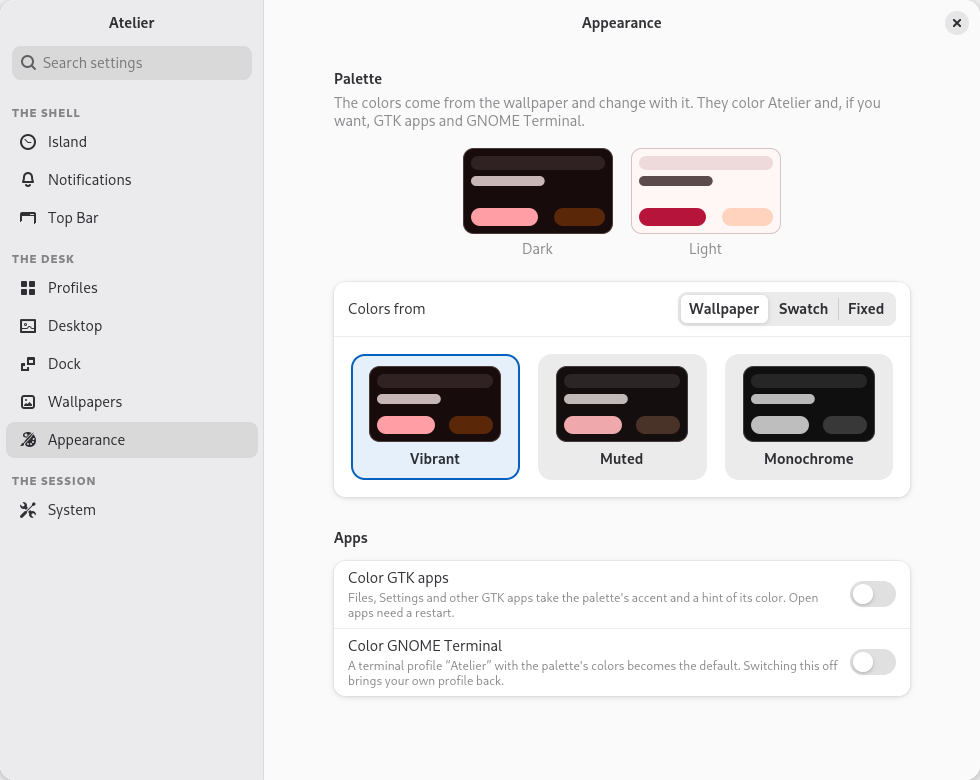</td>
  </tr>
</table>

## Install

Atelier runs on **GNOME Shell 48, 49 and 50** (shell extensions are tied to
the versions of GNOME they were made for). It needs `git`, `make`,
`glib-compile-schemas` (on Debian and Ubuntu in `libglib2.0-bin`, on Fedora in
`glib2`) and `gnome-extensions` (comes with GNOME Shell).

```sh
git clone https://github.com/knespii/atelier.git
cd atelier
make install          # links this folder into ~/.local/share/gnome-shell/extensions/atelier@local
```

On Wayland GNOME Shell only notices new extensions after you log out and back
in. Then enable it:

```sh
gnome-extensions enable atelier@local
```

Shell themes are applied through the **User Themes** extension, which has to
be enabled as well.

To update, pull and build the settings schema again, then log out and back in:

```sh
git pull
make
```

### Ubuntu 26.04 / GNOME 50

Ubuntu 26.04 comes with GNOME 50, which Atelier supports like 48 and 49.
Install the tools first (the Extensions app is the
`gnome-shell-extension-prefs` package):

```sh
sudo apt install git make libglib2.0-bin gnome-shell-extension-prefs
```

Then either install from git as above, or from a zip built with `make pack`
(`gnome-extensions install` compiles the settings schema itself):

```sh
gnome-extensions install --force atelier@local.shell-extension.zip
```

Ubuntu brings two extensions of its own that do the same jobs as parts of
Atelier: **Ubuntu Dock** and **Desktop Icons**. To use Atelier's dock and
desktop widgets, turn them off in the Extensions app (or with
`gnome-extensions disable ubuntu-dock@ubuntu.com` and
`gnome-extensions disable ding@rastersoft.com`). Atelier never turns them off
itself; while they are on, its settings show a notice on the Dock and Desktop
pages. Then log out and back in, and enable Atelier:

```sh
gnome-extensions enable atelier@local
```

## Themes: why they used to break the desktop

- **Shell themes are tied to the GNOME version.** A theme made for GNOME 42 or
  older doesn't know the quick settings menu, the new notifications and other
  parts of GNOME 48 and later, so the shell ends up half styled and partly
  broken. Atelier flags such themes (Settings → System → Theme Check, and in
  the profile editor). Use themes that list support for your GNOME version.
- **Most GNOME apps ignore GTK themes.** Apps built with libadwaita (Files,
  Settings, Text Editor, …) don't read the `gtk-theme` setting at all; only
  GTK 3 apps do. A theme can still restyle them if it ships a `gtk-4.0`
  folder: turn on *Also theme GTK 4 / libadwaita apps* in a profile and
  Atelier imports that stylesheet into `~/.config/gtk-4.0/gtk.css`, following
  the light/dark style.
- **Archives in `~/.themes`** (e.g. `Theme.tar.xz`) make the User Themes
  settings fail to list themes. Extract them and remove the archive.
- If something goes wrong anyway: Settings → System → **Reset Appearance to
  GNOME Defaults**, or switch to the *Original* profile.

## Where things are stored

| What | Where |
| --- | --- |
| Profiles and settings | GSettings `org.gnome.shell.extensions.atelier` |
| Copies of the wallpapers | `~/.local/share/atelier/wallpapers/` |
| Notes | `~/.local/share/atelier/notes.json` |
| Photos (the gallery's copies of them) | `~/.local/share/atelier/photos/` |
| Thumbnails, smaller copies of the photos (for the grids, and as big as the widgets show them), generated shell styles | `~/.cache/atelier/` |
| The depth effect's models (when downloaded) | `~/.local/share/atelier/models/depth-anything-v2-*.onnx`, `birefnet-lite.onnx` |
| The depth effect's cutout of the wallpaper (the current one's) | `~/.cache/atelier/depth/` |
| GTK styles (optional) | `~/.config/gtk-4.0/gtk.css`, `~/.config/gtk-3.0/gtk.css` |
| Terminal colors (optional) | GNOME Terminal profile "Atelier" |

Wallpapers are copied when a profile keeps them, because the original file may
be moved or overwritten (the wallpaper portal always writes to
`~/.config/background`). Deleting a profile deletes its copies, unless the
desktop is still showing them.

## Development

| Command | What it does |
| --- | --- |
| `make check` | Validates the schemas and the syntax of every module |
| `make test` | Unit tests for the shared modules (`tests/`) |
| `make shell-test` | Runs the extension in a throwaway headless GNOME Shell and checks the island, notifications, the control centre, the bar, widgets, photos, notes, the dock, switching, the transition, the palette, GTK styles, terminal colors, saving and moving profiles and the Wallpapers tab; then, on two monitors (the second one to the right of the main one, then to its left), that the notes stay on the main one; screenshots land in `tests/output/shell` and `tests/output/shell-two-monitors` |
| `make prefs` | Opens the preferences without the Extensions app (settings in memory) |
| `make prefs-screenshots` | Renders every settings section headlessly and drives the main flows |
| `make showcase` | Takes the pictures in `docs/screenshots` in a headless GNOME Shell on a 4K monitor at scale 2, with a few profiles of GNOME's own wallpapers (the settings pictures come from `make prefs-screenshots`); `ATELIER_SHOWCASE_FRAMES=<folder> tools/showcase.sh` also records a few moments in slow motion, frame by frame, for a video |
| `make pack` | Builds `dist/atelier@local.shell-extension.zip` |

The test sessions use their own settings, data, cache and runtime
directories under `tests/output`, so they never touch the running desktop.

The same suites run against GNOME Shell 50 in an Ubuntu 26.04 container
(with Ubuntu Dock and Desktop Icons installed): `tools/gnome50/run.sh
[main|two-monitors|dock|prefs]` builds the image with `podman` the first
time, mounts the repository read-only (run `make` first, for the compiled
schema) and puts the results in `tests/output/gnome50/<suite>/run`.

Layout:

- `extension.js` – starts the modules
- `shell/` – runs inside GNOME Shell: `core/` (module manager, generated
  styles, glass, GTK and terminal colors), the profiles module (switcher,
  transition, applying and saving profiles), the palette module,
  `island/` (the island, its pages and the sheet that drips from it),
  `notifications/` (banners in the island), `controlCentre/` (quick settings
  and extension icons in the island), `bar/` (the top bar's look),
  `claude/` (Claude Code's numbers), `desktop/` (the widgets), `notes/` and
  `dock/`
- `prefs.js`, `prefs/` – the settings app (GTK 4 / libadwaita)
- `lib/` – shared by both: profiles, palette, theme discovery,
  thumbnails, GTK stylesheets, terminal profile, widgets' layout, notes
- `tools/` – development harnesses
- `docs/` – the pictures and the video in this README

## Uninstall

```sh
gnome-extensions disable atelier@local
make uninstall
```

Switch off *Color GTK apps* and *Color GNOME Terminal* first (or use Reset
Appearance) to remove Atelier's GTK styles and terminal profile. The copied
wallpapers, the photos and the notes stay in `~/.local/share/atelier` until
you delete that folder.

## License

Atelier is free software: you can redistribute it and/or modify it under the
terms of the GNU General Public License as published by the Free Software
Foundation, either version 2 of the License, or (at your option) any later
version – see [LICENSE](LICENSE).
